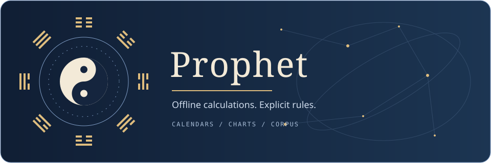
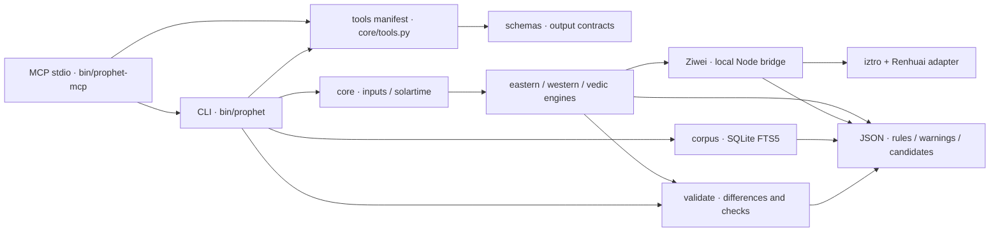

[简体中文](README.md) | [English](README.en.md)

<div align="center">
  
</div>

<div align="center">

[](LICENSE)


[](https://github.com/AstralumeLan/prophet-toolkit/actions/workflows/ci.yml)

[](https://github.com/AstralumeLan/prophet-toolkit/releases)
[](docs/for-ai.md)
[](llms.txt)

[](https://github.com/AstralumeLan/prophet-toolkit)

</div>

<p align="center"><strong>Traditional systems. Astronomical calculations. One offline CLI.</strong></p>

Prophet computes charts, preserves sources and makes rule differences visible. Python unifies inputs and JSON output; Ziwei runs through a local Node bridge.

**Contents**

[✨ Features](#features) · [🚀 Quick start](#quick-start) · [📦 Examples](#examples) · [🤖 AI-friendly](#ai-friendly) · [🏗️ Architecture](#architecture) · [🎯 Accuracy and validation](#accuracy) · [🧰 CLI reference](#cli) · [🗺️ Roadmap / known gaps](#roadmap) · [❓ FAQ](#faq) · [🤝 Contributing](#contributing) · [📄 Licence and acknowledgements](#license) · [⚠️ Disclaimer](#disclaimer)

<a id="features"></a>

## ✨ Features

| System | Capabilities | Docs |
| --- | --- | --- |
| ☯️ Bazi | Four pillars, luck cycles, annual/monthly forecasts and shensha | [Bazi](docs/bazi.md) |
| 🌌 Ziwei | Dual adapters, major/minor cycles and year/month/day/hour flows | [Ziwei](docs/ziwei.md) |
| 🪙 Liuyao | Coin, time and manual casts; najia and hidden relatives | [Liuyao](docs/liuyao.md) |
| 🌸 Meihua | Time, number and random casts; primary, mutual and changed hexagrams | [Meihua](docs/meihua.md) |
| 🧭 Qimen | Hour-based rotating charts with chaibu and zhirun rules | [Qimen](docs/qimen.md) |
| 📅 Almanac | Lunar calendar, solar terms, daily and hourly entries | [Almanac](docs/huangli.md) |
| ♈ Western | Natal charts, transits, progressions, solar returns and synastry | [Western](docs/western.md) |
| 🃏 Tarot | RWS draws, spreads and keyword lookup | [Tarot](docs/tarot.md) |
| 🪐 Vedic | Lahiri, vargas, Vimshottari, BAV and optional Shadbala | [Vedic](docs/vedic.md) |
| 📚 Corpus | SQLite FTS5 search with source and licence metadata | [Corpus](docs/corpus.md) |
| 🔬 Validation | Field-level differences, rule notes and limited independent checks | [Validation](docs/validate.md) |
| ⚙️ Core | True solar time, approximate-time branches and recorded draw reuse | [Core](docs/core.md) |

<a id="quick-start"></a>

## 🚀 Quick start

Requires **Python 3.12, Node.js 20+, npm, git, curl and bash**. The Node package declares no `engines`; 20+ is the setup baseline used here.

```bash
git clone https://github.com/AstralumeLan/prophet-toolkit.git
cd prophet-toolkit
bash scripts/setup.sh
bin/prophet bazi chart --person S01
```

Setup needs a network connection; installed calculations and search run offline. The script creates `.venv`, installs pinned Python dependencies and locked npm packages, fetches fixed upstream commits and optional Chiron data, builds the corpus and runs selftest. It uses uv when available, otherwise venv/pip. Building pyswisseph from source requires a C/C++ compiler and Python headers.

S01–S04 are fictional fixtures: exact, interval, provisional and interval respectively. If dependencies and vendor sources are already prepared, use `bin/prophet corpus build` offline.

<a id="examples"></a>

## 📦 Examples

These commands were run for this README. Outputs below retain original keys and values; `…` marks omitted fields and is not JSON syntax. S03 remains provisional.

```bash
bin/prophet bazi chart --person S01
```

```jsonc
{
  "person": "S01",
  "candidates": [
    {
      "year_pillar": "庚午",
      "month_pillar": "己卯",
      "day_pillar": "己卯",
      "hour_pillar": "戊辰",
      "day_master": "己"
    }
  ],
  …
}
```

```bash
bin/prophet ziwei horoscope --person S01 --date 2026-01-01
```

```jsonc
{
  "target": {
    "date": "2026-01-01",
    "hour": null
  },
  "solarDate": "2026-1-1",
  "lunarDate": "二〇二五年冬月十三",
  …
}
```

```bash
bin/prophet western natal --person S03
```

```jsonc
{
  "engine": {
    "name": "western.astro"
  },
  "invariants": {
    "不随时间变化": {
      "Sun sign": "Cancer",
      "Moon sign": "Pisces"
    }
  },
  …
}
```

<a id="ai-friendly"></a>

## 🤖 AI-friendly

`bin/prophet tools --pretty` and `bin/prophet --describe` return the same JSON tool manifest. Parameters, types, enums and defaults come directly from the argparse command tree. This is a trimmed real output (`…` marks omissions, so it is not complete JSON):

```jsonc
{
  "tools": [
    …,
    {
      "name": "bazi.chart",
      "description": "八字四柱、大运、流年流月",
      "parameters": {
        "type": "object",
        "properties": {
          …,
          "sect": {"type": "integer", "enum": [1, 2], "default": 2},
          …
        },
        "required": [],
        "additionalProperties": false
      },
      "output_schema": "schemas/bazi.chart.schema.json"
    },
    …
  ]
}
```

[schemas/](schemas/) contains per-command output contracts using JSON Schema draft 2020-12, allowing additive fields. Nested structures are intentionally permissive. `required: []` does not mean empty inputs work: engines still check alternatives such as person OR date/location.

After setup, run `bin/prophet-mcp` for MCP JSON-RPC over stdin/stdout. Tool names such as `bazi_chart` use parameters from the same manifest. Claude Desktop / Cursor style configuration (replace the illustrative path with your local checkout):

```json
{
  "mcpServers": {
    "prophet": {
      "command": "/opt/prophet-toolkit/bin/prophet-mcp",
      "args": []
    }
  }
}
```

MCP exposes the full CLI, including local record queries and explicit persistence; connect only trusted clients. Random tools preserve ordinary draw reuse and redraw rules. The server starts no network listener.

[llms.txt](llms.txt) indexes the docs, [llms-full.txt](llms-full.txt) combines public technical documentation, and [AGENTS.md](AGENTS.md) defines agent contribution, testing and privacy rules. See the [AI client guide](docs/for-ai.md) for protocol details, calls and recommended workflows.

## 🧩 Agent Skills

Optional [Bazi](skills/bazi/SKILL.md) and [Ziwei](skills/ziwei/SKILL.md) skills guide chart inspection, staged interpretation, corpus retrieval and a final Critic pass. References use actual JSON paths, distinguish schools and timing layers, and preserve counter-interpretations and uncertain-time branches. AI clients load these files as needed; no model service or additional dependency is required.

## 🔎 Evidence

Each claim can carry `system`, `json_paths`, `school`, `rule_id`, `corpus_reference`, `confidence` and `counter_interpretation`. Save the raw chart and evidence list locally using the [evidence contract](docs/agent-workflows.md), then run:

```bash
bin/prophet evidence check evidence.json
```

The validator rejects missing fields and unsupported paths, returning the resolved values. Passing confirms structure and reference existence; reviewers still check meaning, source authenticity and rule applicability. Evidence files can contain personal data: review them before sharing.

## 🔀 Cross-check

```bash
bin/prophet cross-check run --person S01
bin/prophet cross-check run --person S02 --systems bazi,ziwei,western
```

Run at least two systems independently and receive compact facts, rules, warnings, candidate branches and `agreements/conflicts/unique`. Eastern calculations share clock time by default. Matching pillar value sets describe calendar agreement; system-specific facts retain their own meanings. Add `--include-charts` for raw-chart review. The [cross-check skill](skills/cross-check/SKILL.md) separately compares interpreted themes without treating calendar agreement as predictive consensus. Single-agent use is the default; deeper multi-agent review is documented as optional.

MCP automatically exposes `evidence_check` and `cross_check_run` through the existing tested stdio transport. Official SDK migration is deferred. See the [full workflow guide](docs/agent-workflows.md).

<a id="architecture"></a>

## 🏗️ Architecture



[Design specification](docs/SPEC.md) · [Shared input layer](docs/core.md)

<a id="accuracy"></a>

## 🎯 Accuracy and validation

This offline run reported **124/124 passed** (the static tests badge). With Chiron ephemeris data present, numeric and derived checks ran; missing-data fallback checks also passed.

Tests check calculations and documented rules, not predictive power. The table summarizes assertions in [tests](tests/) rather than general accuracy guarantees.

| System | Reference | Tolerance / result checked |
| --- | --- | --- |
| Bazi | lunar-python README example | 乙酉 · 戊子 · 辛巳 · 壬辰 |
| Ziwei | iztro README chart | Soul 午, body 戌, bureau 木三局; Ziwei 午, Tianfu 戌 |
| Ziwei | Independent placement subset | 40 seeded charts + 6 boundary cases; 14 major stars + 4 auxiliary stars |
| Qimen | Published zhirun examples (1898, 1901, 1959, 1996, 2024) | Term, yuan, dun and ju |
| Western | Einstein public LMT chart | ASC Cancer 11.65° ±0.1°; Sun 353.5° ±0.05°; Moon 254.5° ±0.1° |
| Western | J2000 TT, Swiss Ephemeris | Sun 280.37° ±0.02°; Moon 223.32° ±0.1° |
| Western | astronomy-engine, 3 epochs | First 7 bodies: longitude difference <1 arcminute |
| Chiron | Astrodienst annual tables, J2000 UT | 251.62° ±0.02°; optional ephemeris required |
| Vedic | Lahiri J2000 TT | Ayanamsa 23.85° ±0.02° |
| Vedic | BAV tables / profiles | Planet totals [48, 49, 39, 54, 56, 52, 39]; total 337 |
| Shadbala | B. V. Raman, Graha and Bhava Balas | 7 planetary totals: ±0.15 rupa; selected components ±0.10 virupa |

Shared-library agreement is not independent validation: Renhuai also calls iztro. The independent Ziwei check covers a subset of placements. Frozen fictional fixtures document their provenance in test comments; matching them is a regression check. Chiron reference tests report a skip note when its optional file is absent; missing-file fallback is still tested. See [validation rules](docs/validate.md).

<a id="cli"></a>

## 🧰 CLI reference

<details>
<summary>Commands and documentation</summary>

Use `bin/prophet --help` or any subcommand’s `--help` for full options. `--pretty` works anywhere.

| System | Commands |
| --- | --- |
| person / geo / solartime | list · show · resolve / place lookup / time correction |
| cache / draws | list |
| bazi | chart · liunian · liuyue · daily |
| ziwei | chart · compare · horoscope |
| liuyao | coins · time · manual |
| meihua | time · numbers · coins · random |
| qimen / huangli | chart / day |
| western | natal · check · transits · progressions · solar-return · synastry |
| tarot | draw · card |
| vedic | chart · dasha · nakshatra · shadbala |
| corpus | build · search · get · books |
| validate | all · bazi · ziwei · western · vedic |
| tools / --describe | JSON manifest |
| selftest | -k PATTERN |

</details>

<details>
<summary>JSON conventions and time uncertainty</summary>

Most calculation results contain `engine: {name, version, rules}`, `warnings` and parsed `input`. Additive explanations use `rules_ext`, sometimes inside `engine`. Bazi uses `candidates`; many other systems use `branches`. Helper commands may return arrays. Errors contain `error/message/trace` and exit nonzero; selftest also exits nonzero on failure. Dates serialize as strings.

Use `--person S01` or explicit `--date`, `--time` and `--place`; custom coordinates use `--lat --lon --tz` with an IANA timezone. Original clock time is preserved alongside true solar time. City centres are approximate; historical local mean time needs separate handling. Bazi defaults to true solar time; Ziwei defaults to clock time. Align rules before comparing.

Use `--time-range 20:00-21:00` for an interval. No midpoint is silently confirmed. Eastern systems branch at relevant double-hour, date and solar-term boundaries. Western and Vedic charts sample every 15 minutes plus endpoints: `invariants` describe computed samples, not the entire continuous interval. Unknown times may be rejected; Western charts can use a noon placeholder with unreliable-house warnings.

</details>

<a id="roadmap"></a>

## 🗺️ Roadmap / known gaps

These are current gaps and areas for future work, not promised delivery dates.

- Broader school coverage and critically collated classical sources; shensha matches do not score fortune.
- Qimen remains a reference-compatible chart implementation.
- Vedic: no automatic birth-time rectification, D60, yogas or BAV reductions; historical mean-motion Shadbala approximations need more independent samples.
- Chiron is omitted with a warning if `seas_18.se1` is absent or out of range.
- Corpus hits supply source context, not personal conclusions.

<a id="faq"></a>

## ❓ FAQ

<details>
<summary>Does it work offline?</summary>

Yes, after setup. Dependency installation, upstream checkouts and ephemeris download need network access; runtime calculation and local corpus search do not.

</details>

<details>
<summary>How accurate is it?</summary>

See the reference table and per-system docs. Rule choices and warnings remain explicit. Agreement between engines is not proof of predictive validity.

</details>

<details>
<summary>What if the birth time is approximate?</summary>

Use a time interval or a fictional interval fixture such as S02. Results retain branches; sampled invariants do not establish certainty between samples. Provisional times remain provisional.

</details>

<details>
<summary>Why Node?</summary>

The Ziwei bridge runs iztro and the Renhuai adapter locally over stdin/stdout JSON. It does not start a network service.

</details>

<details>
<summary>Is everything MIT? What about pyswisseph?</summary>

Original code is MIT. Third-party components retain their terms. The repository’s notices state that combined distributions linking pyswisseph carry AGPL obligations; Swiss Ephemeris also offers commercial licensing, which does not automatically relicense its Python wrapper. Read [THIRD_PARTY_NOTICES.md](THIRD_PARTY_NOTICES.md) and upstream terms before distribution.

</details>

<details>
<summary>Where should real birth records go?</summary>

Only in gitignored `core/people.json`; when absent, the CLI loads fictional `core/people.example.json`. Never publish personal records, caches, draw journals, credentials or personalized reports. Review `input` and `trace` before sharing output.

</details>

<details>
<summary>Will the same question draw again?</summary>

Recorded random casts reuse the same method/question result. An explicitly different seed flags a redraw. The default journal is ignored `core/draws.jsonl` and stores the question text. `--no-record` prevents new writes but does not disable reuse of existing records; use temporary journals for tests.

</details>

<details>
<summary>Why is Tianji excluded by default?</summary>

The course retains CC BY-NC-SA 4.0 restrictions. Enable it only after accepting those terms with `bash scripts/setup.sh --with-tianji` or `bin/prophet corpus build --with-tianji`. Prophet’s MIT licence does not remove NonCommercial or ShareAlike requirements.

</details>

<a id="contributing"></a>

## 🤝 Contributing

Start with [CONTRIBUTING.md](CONTRIBUTING.md) and the [Code of Conduct](CODE_OF_CONDUCT.md). Use the [issue templates](.github/ISSUE_TEMPLATE/) for reproducible bugs or feature requests; report vulnerabilities privately under the [security policy](SECURITY.md). See [CHANGELOG.md](CHANGELOG.md) for version history. Keep runtime offline, document rule sources and frozen fixtures, and test persistence in temporary directories. Run:

```bash
bin/prophet selftest
bin/prophet selftest -k western_chiron
bin/prophet selftest -k corpus
```

Before release, inspect the actual file list: exclude private inputs, caches, journals, vendor checkouts, node_modules, generated corpora, SQLite indexes and ephemeris data. Preserve third-party LICENSE/NOTICE files.

<a id="license"></a>

## 📄 Licence and acknowledgements

Original code: [MIT](LICENSE). Dependencies, texts and ephemeris data retain separate terms; see [THIRD_PARTY_NOTICES.md](THIRD_PARTY_NOTICES.md).

Thanks to [iztro](https://github.com/SylarLong/iztro), [6tail lunar-javascript](https://github.com/6tail/lunar-javascript) / [lunar-python](https://github.com/6tail/lunar-python), [Swiss Ephemeris](https://www.astro.com/swisseph/) / [pyswisseph](https://github.com/astrorigin/pyswisseph), [astronomy-engine](https://github.com/cosinekitty/astronomy), [Renhuai123/ziwei-doushu](https://github.com/Renhuai123/ziwei-doushu), [chinese-fortune](https://github.com/ShousenZHANG/chinese-fortune) and [dashaflow](https://github.com/adarshj322/dashaflow).

B. V. Raman’s *Graha and Bhava Balas* supplies numerical reference examples; no book text or scans are bundled.

<a id="disclaimer"></a>

## ⚠️ Disclaimer

For entertainment and cultural study only. No deterministic claims about personal fate, and no medical, legal, investment or other professional advice.

---

> 🤖 Made with AI.
