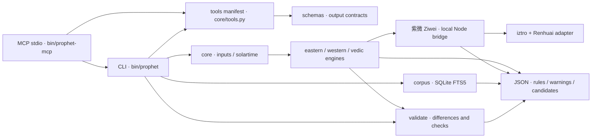

[简体中文](README.md) | [English](README.en.md)

<div align="center">
  
</div>

<div align="center">

[](LICENSE)


[](https://github.com/AstralumeLan/prophet-toolkit/actions/workflows/ci.yml)

[](https://github.com/AstralumeLan/prophet-toolkit/releases)
[](docs/for-ai.md)
[](llms.txt)

[](https://github.com/AstralumeLan/prophet-toolkit)

</div>

<p align="center"><strong>传统术数与天文排盘，一个离线 CLI。</strong></p>

Prophet 计算规则、保留来源、展示分歧。Python 统一输入与 JSON 输出，紫微通过本地 Node 桥接；从四柱到星盘，从随机起卦到经典检索，都能追溯计算依据。

**目录**

[✨ 特性](#features) · [🚀 快速开始](#quick-start) · [📦 示例](#examples) · [🤖 AI 友好](#ai-friendly) · [🏗️ 架构](#architecture) · [🎯 准确性与校验](#accuracy) · [🧰 CLI 参考](#cli) · [🗺️ 路线图 / 已知缺口](#roadmap) · [❓ FAQ](#faq) · [🤝 贡献](#contributing) · [📄 许可与致谢](#license) · [⚠️ 免责声明](#disclaimer)

<a id="features"></a>

## ✨ 特性

| 体系 | 能力 | 文档 |
| --- | --- | --- |
| ☯️ 八字 | 四柱、大运、流年流月、日历与神煞 | [八字](docs/bazi.md) |
| 🌌 紫微 | 双适配排盘、大限小限与年/月/日/时运限 | [紫微](docs/ziwei.md) |
| 🪙 六爻 | 铜钱、时间或手工起卦，纳甲与伏神 | [六爻](docs/liuyao.md) |
| 🌸 梅花 | 时间、数字与随机起卦，体用与互变卦 | [梅花](docs/meihua.md) |
| 🧭 奇门 | 时家转盘，拆补与置闰规则 | [奇门](docs/qimen.md) |
| 📅 黄历 | 农历、节气、宜忌与十二时辰 | [黄历](docs/huangli.md) |
| ♈ 西占 | 本命、行运、次限、太阳返照与合盘 | [西占](docs/western.md) |
| 🃏 塔罗 | RWS 抽牌、牌阵与牌义索引 | [塔罗](docs/tarot.md) |
| 🪐 印占 | Lahiri、分盘、Vimshottari、BAV 与可选六力 | [印占](docs/vedic.md) |
| 📚 语料 | SQLite FTS5 全文检索，保留出处与许可 | [语料](docs/corpus.md) |
| 🔬 交叉校验 | 逐项显示差异、规则与有限独立检查 | [交叉校验](docs/validate.md) |
| ⚙️ 核心 | 真太阳时、约略时间分支、随机占不重抽（复用记录） | [核心](docs/core.md) |

<a id="quick-start"></a>

## 🚀 快速开始

准备 **Python 3.12、Node.js 20+、npm、git、curl 和 bash**。Node 包未声明 `engines`，此处以 20+ 作为安装基线。

```bash
git clone https://github.com/AstralumeLan/prophet-toolkit.git
cd prophet-toolkit
bash scripts/setup.sh
bin/prophet bazi chart --person S01
```

安装需要联网，安装后的计算与检索离线运行。脚本创建 `.venv`，安装固定 Python 依赖与 npm 锁定版本，检出固定上游提交，下载可选 Chiron 星历，生成语料并自检；优先使用 uv，否则使用 venv/pip。pyswisseph 源码编译需要 C/C++ 编译器及 Python 头文件。

S01–S04 均为虚构示例，依次为精确时间、区间、暂用时间和区间。已备齐依赖及 vendor 来源时，可离线运行 `bin/prophet corpus build`。

<a id="examples"></a>

## 📦 示例

以下命令已实际运行；节选保留原始键和值，`…` 表示省略字段，展示内容不是可直接解析的完整 JSON。S03 仍为暂用时间。

```bash
bin/prophet bazi chart --person S01
```

```jsonc
{
  "person": "S01",
  "candidates": [
    {
      "year_pillar": "庚午",
      "month_pillar": "己卯",
      "day_pillar": "己卯",
      "hour_pillar": "戊辰",
      "day_master": "己"
    }
  ],
  …
}
```

```bash
bin/prophet ziwei horoscope --person S01 --date 2026-01-01
```

```jsonc
{
  "target": {
    "date": "2026-01-01",
    "hour": null
  },
  "solarDate": "2026-1-1",
  "lunarDate": "二〇二五年冬月十三",
  …
}
```

```bash
bin/prophet western natal --person S03
```

```jsonc
{
  "engine": {
    "name": "western.astro"
  },
  "invariants": {
    "不随时间变化": {
      "Sun sign": "Cancer",
      "Moon sign": "Pisces"
    }
  },
  …
}
```

<a id="ai-friendly"></a>

## 🤖 AI 友好

`bin/prophet tools --pretty` 或 `bin/prophet --describe` 返回相同的 JSON 工具清单，直接从 argparse 命令树发现参数、类型、枚举与默认值。以下为实际输出节选（`…` 表示省略，不是完整 JSON）：

```jsonc
{
  "tools": [
    …,
    {
      "name": "bazi.chart",
      "description": "八字四柱、大运、流年流月",
      "parameters": {
        "type": "object",
        "properties": {
          …,
          "sect": {"type": "integer", "enum": [1, 2], "default": 2},
          …
        },
        "required": [],
        "additionalProperties": false
      },
      "output_schema": "schemas/bazi.chart.schema.json"
    },
    …
  ]
}
```

[schemas/](schemas/) 提供逐命令的 JSON Schema（draft 2020-12）输出契约，允许新增字段；嵌套结构有意保持宽松。参数的 `required: []` 不代表空输入有效，人物或日期/地点等替代条件仍由引擎检查。

安装后运行 `bin/prophet-mcp`，通过 stdin/stdout 提供 MCP JSON-RPC 工具；工具名如 `bazi_chart`，参数来自同一清单。Claude Desktop / Cursor 风格配置如下，请把示例路径替换为本地检出位置：

```json
{
  "mcpServers": {
    "prophet": {
      "command": "/opt/prophet-toolkit/bin/prophet-mcp",
      "args": []
    }
  }
}
```

MCP 暴露完整 CLI，包括本地记录查询与显式持久化；只连接可信客户端。随机工具保持原有复用与重抽规则，服务不启动网络监听。

[llms.txt](llms.txt) 是精简文档入口，[llms-full.txt](llms-full.txt) 汇集公开技术文档，[AGENTS.md](AGENTS.md) 规定代理协作、测试和隐私要求。协议、调用示例与建议流程见 [AI 客户端指南](docs/for-ai.md)。

<a id="architecture"></a>

## 🏗️ 架构



[通用设计规格](docs/SPEC.md) · [公共输入层](docs/core.md)

<a id="accuracy"></a>

## 🎯 准确性与校验

本次离线自检报告 **112/112 passed**（静态测试徽章）；Chiron 星历已备齐，数值与衍生检查均运行，缺失数据降级路径也通过。

测试检验计算结果和已声明规则，不检验预测能力。下表概括 [tests](tests/) 中的断言，不代表对整套体系的准确性保证。

| 体系 | 参考 | 容差 / 实际检查结果 |
| --- | --- | --- |
| 八字 / Bazi | lunar-python README example | 乙酉 · 戊子 · 辛巳 · 壬辰 |
| 紫微 / Ziwei | iztro README chart | 命午、身戌、木三局；紫微午、天府戌 / soul 午, body 戌, bureau 木三局 |
| 紫微 / Ziwei | Independent placement subset | 40 seeded charts + 6 boundary cases; 14 major stars + 4 auxiliary stars |
| 奇门 / Qimen | Published zhirun examples (1898, 1901, 1959, 1996, 2024) | 节气、三元、阴阳遁与局数 / term, yuan, dun and ju |
| 西占 / Western | Einstein public LMT chart | ASC Cancer 11.65° ±0.1°; Sun 353.5° ±0.05°; Moon 254.5° ±0.1° |
| 西占 / Western | J2000 TT, Swiss Ephemeris | Sun 280.37° ±0.02°; Moon 223.32° ±0.1° |
| 西占 / Western | astronomy-engine, 3 epochs | First 7 bodies: longitude difference <1 arcminute |
| Chiron | Astrodienst annual tables, J2000 UT | 251.62° ±0.02°; optional ephemeris required |
| 印占 / Vedic | Lahiri J2000 TT | Ayanamsa 23.85° ±0.02° |
| 印占 / Vedic | BAV tables / profiles | Planet totals [48, 49, 39, 54, 56, 52, 39]; total 337 |
| 六力 / Shadbala | B. V. Raman, Graha and Bhava Balas | 7 planetary totals: ±0.15 rupa; selected components ±0.10 virupa |

共享库的一致不等于独立校验：Renhuai 内部也调用 iztro；紫微独立检查仅覆盖部分排星。虚构冻结数值在测试注释中记录来源，只用于回归。Chiron 可选文件缺失时，数值参考测试打印跳过说明，缺失降级仍被测试。详见 [校验规则](docs/validate.md)。

<a id="cli"></a>

## 🧰 CLI 参考

<details>
<summary>展开命令与文档入口</summary>

完整选项见 `bin/prophet --help` 与各子命令的 `--help`。`--pretty` 可放任意位置。

| 体系 | 子命令 |
| --- | --- |
| person / geo / solartime | list · show · resolve / place lookup / time correction |
| cache / draws | list |
| bazi | chart · liunian · liuyue · daily |
| ziwei | chart · compare · horoscope |
| liuyao | coins · time · manual |
| meihua | time · numbers · coins · random |
| qimen / huangli | chart / day |
| western | natal · check · transits · progressions · solar-return · synastry |
| tarot | draw · card |
| vedic | chart · dasha · nakshatra · shadbala |
| corpus | build · search · get · books |
| validate | all · bazi · ziwei · western · vedic |
| tools / --describe | JSON manifest |
| selftest | -k PATTERN |

</details>

<details>
<summary>JSON 约定与时间不确定性</summary>

多数计算结果含 `engine: {name, version, rules}`、`warnings` 与解析后的 `input`；补充说明放 `rules_ext`，部分位于 `engine` 内。八字使用 `candidates`，多体系使用 `branches`。辅助命令可能直接返回数组。错误含 `error/message/trace`，退出码非零；selftest 失败也非零。日期时间序列化为字符串。

输入用 `--person S01`，或显式 `--date`、`--time`、`--place`；自定义坐标用 `--lat --lon --tz` 与 IANA 时区。原始钟表时保留，真太阳时另列。市中心坐标是近似值，历史地方平时须单独处理。八字默认真太阳时，紫微默认钟表时；比较前应对齐规则。

区间用 `--time-range 20:00-21:00`，不会把中点默认为确认时间。东方法按相关时辰、日期和节气边界分支；西占与印占每 15 分钟加端点取样。`invariants` 只描述实际样本，不能证明整个连续区间稳定。未知时间部分体系拒绝；西占可用中午占位，并警告宫位不可靠。

</details>

<a id="roadmap"></a>

## 🗺️ 路线图 / 已知缺口

以下是当前缺口与后续改进方向，不代表交付承诺。

- 扩展流派覆盖与经典校勘；神煞命中不作吉凶评分。
- 奇门仍为参考兼容盘，不能概括所有流派。
- 印占尚无自动校时、D60、瑜伽或 BAV 消减；六力历史平运动近似缺少更多独立样本。
- Chiron 缺少 `seas_18.se1` 或超出覆盖范围时省略并警告。
- 语料命中提供出处线索，不直接支持个人推断。

<a id="faq"></a>

## ❓ FAQ

<details>
<summary>能完全离线运行吗？</summary>

可以。依赖安装、上游检出和星历下载需要联网；准备完成后的计算和本地语料检索不访问网络。

</details>

<details>
<summary>准确性如何理解？</summary>

请结合参考表和各体系文档理解。规则选择与警告会明确输出；引擎一致不构成预测有效性的证明。

</details>

<details>
<summary>出生时间不确定怎么办？</summary>

使用时间区间，或查看 S02 虚构区间示例。输出保留分支；样本间的不变不能代表连续区间确定。暂用时间也仍是暂用输入。

</details>

<details>
<summary>为什么需要 Node？</summary>

紫微通过 stdin/stdout JSON 在本地调用 iztro 与 Renhuai 适配，不启动网络服务。

</details>

<details>
<summary>都是 MIT 吗？pyswisseph 的 AGPL 怎么办？</summary>

原创代码为 MIT，第三方保留各自条款。项目第三方说明明确：链接 pyswisseph 的组合发行物受 AGPL 义务约束；Swiss Ephemeris 另有商业许可，但不会自动重新许可 Python 包装层。分发前阅读 [第三方说明](THIRD_PARTY_NOTICES.md) 及上游条款。

</details>

<details>
<summary>真实出生资料放在哪里？</summary>

只放在 gitignored 的 `core/people.json`；不存在时加载虚构 `core/people.example.json`。不要发布个人档案、缓存、抽签日志、凭据或个性化报告；分享输出前检查 `input` 与 `trace`。

</details>

<details>
<summary>同一个问题会反复重抽吗？</summary>

记录中的同方法同问题复用原结果；显式不同 seed 会标记重抽。默认日志为已忽略的 `core/draws.jsonl`，含问题原文。`--no-record` 阻止新增记录，但不禁用已有记录复用；测试使用临时日志。

</details>

<details>
<summary>为什么默认不启用天纪？</summary>

课程保留 CC BY-NC-SA 4.0 限制。接受条款后才用 `bash scripts/setup.sh --with-tianji` 或 `bin/prophet corpus build --with-tianji` 显式启用。Prophet 的 MIT 不会消除非商业与相同方式共享要求。

</details>

<a id="contributing"></a>

## 🤝 贡献

请先阅读 [贡献指南](CONTRIBUTING.md) 与 [行为准则](CODE_OF_CONDUCT.md)。通过 [Issue 模板](.github/ISSUE_TEMPLATE/) 提交可复现问题或功能建议；安全问题按 [安全政策](SECURITY.md) 私下报告。版本变更见 [CHANGELOG.md](CHANGELOG.md)。保持运行离线，记录规则与冻结数值来源，持久化测试使用临时目录。提交改动前运行：

```bash
bin/prophet selftest
bin/prophet selftest -k western_chiron
bin/prophet selftest -k corpus
```

发布前检查实际文件清单：排除私有输入、缓存、日志、vendor 检出、node_modules、生成语料、SQLite 索引及星历数据；保留第三方 LICENSE/NOTICE。

<a id="license"></a>

## 📄 许可与致谢

原创代码采用 [MIT](LICENSE)。依赖、文本与星历保留独立条款，详见 [THIRD_PARTY_NOTICES.md](THIRD_PARTY_NOTICES.md)。

感谢 [iztro](https://github.com/SylarLong/iztro)、[6tail lunar-javascript](https://github.com/6tail/lunar-javascript) / [lunar-python](https://github.com/6tail/lunar-python)、[Swiss Ephemeris](https://www.astro.com/swisseph/) / [pyswisseph](https://github.com/astrorigin/pyswisseph)、[astronomy-engine](https://github.com/cosinekitty/astronomy)、[Renhuai123/ziwei-doushu](https://github.com/Renhuai123/ziwei-doushu)、[chinese-fortune](https://github.com/ShousenZHANG/chinese-fortune) 与 [dashaflow](https://github.com/adarshj322/dashaflow)。

B. V. Raman 的 *Graha and Bhava Balas* 提供数值参考例；本项目不附书籍正文或扫描件。

<a id="disclaimer"></a>

## ⚠️ 免责声明

仅供娱乐与文化研究，不对个人命运作确定性判断，不构成医疗、法律、投资或其他专业建议。
